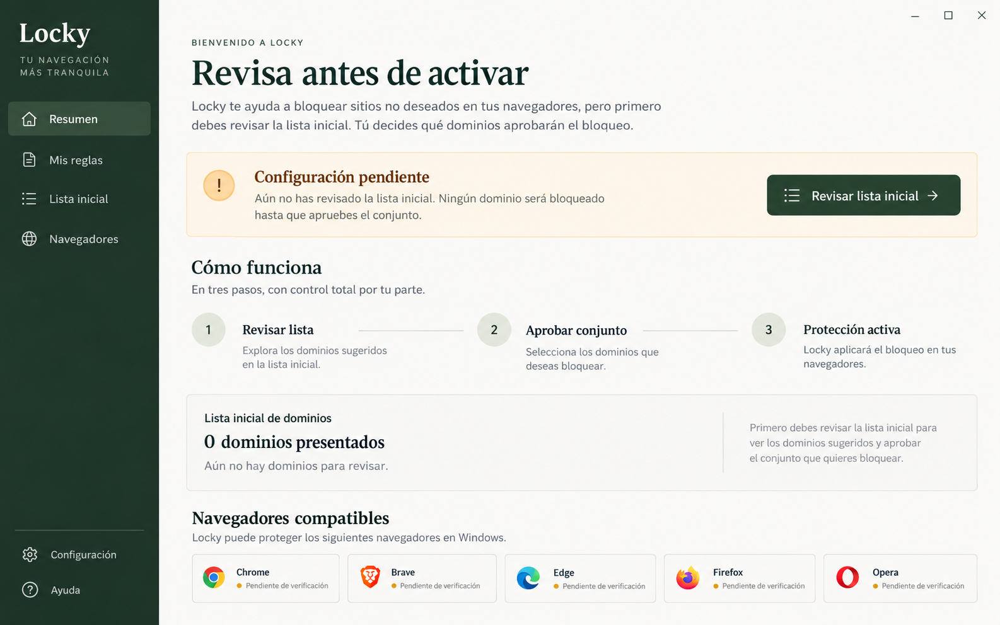

# Two Directions for Locky Desktop

These images are visual proposals generated with the integrated imagegen tool. They do not represent implemented features. The current prototype in `design/` and the active `DESIGN.md` were not changed.

## A v2 · Everyday Energy

Revision of proposal A following the user's feedback: no green and no formal tone. Electric blue, orange, lilac, and midnight ink; large headlines and clear controls. Reviewing the initial set remains the main task. This version replaces direction A for future decisions; the first image remains below as a record of the rejected exploration.

**Before implementation:** the mockup says browser connections will be checked after approving the set. That order is not established in the specification and must be removed. The “Settings” and “Help” areas are exploratory and are not yet specified features.

**Generation prompt:**

> Use case: ui-mockup. Asset type: revised desktop app design proposal for Locky Desktop, a personal Windows app. Create one high-fidelity 16:10 screenshot-like interface, no device frame. Replace the earlier green, formal first-run design with something bold, fresh, friendly, and energetic while remaining a practical operating interface. Absolutely no green. No botanical, institutional, editorial-serious, bank-like, or corporate look. Spanish first-run overview. The initial adult/gambling domain list has not been supplied and no protection is active. Headline “Primero, revisa la lista.” Status “Configuración pendiente”. Main action “Revisar lista inicial”. Empty-list panel “0 dominios presentados” and “Aún no hay dominios para revisar”. Chrome, Brave, Edge, Firefox, Opera individually “Pendiente de verificación”. Navigation: Resumen, Mis reglas, Lista inicial, Navegadores. Product name “Locky Desktop”. Explain approval of the initial list as a set and the ten-minute cancellation window for new personal rules. Expressive modern desktop utility, electric blue, tangerine, lilac, chalk white, midnight ink. Playful typography, confident asymmetry, crisp vector geometry, readable controls. Bold color fields, no standard white dashboard with colored cards. No gradients, glow, glass, lock-shaped hero art, fake metrics, invented domains, misleading active status, people, photos, or watermark.

## A Original · First Review (Rejected)

A calm interface that makes the initial decision visible: what is pending, what will be approved, and which browsers have not yet been verified. Deep green, a light background, editorial text, and one clear primary action. It works best if the first-run experience and trust in setup are the priority.

**Before implementation:** the mockup says users select individual domains; the specification requires reviewing and approving the initial set **as a whole**. Chrome, Brave, Edge, Firefox, and Opera must not be shown as protected until each integration is verified.

**Generation prompt:**

> Use case: ui-mockup. Asset type: desktop UI concept composition for Locky Desktop, a personal Windows app. Create one high-fidelity 16:10 screenshot-like application interface, no device frame. Design direction A: a calm, precise personal protection control room. Spanish UI. Main screen is the first-run overview: local protection has not been configured; the initial domain list must be reviewed before any domain is blocked. No fake domain entries or protection claims. Slim forest-green left navigation with Locky wordmark and Resumen, Mis reglas, Lista inicial, Navegadores. Warm-white main workspace, headline “Revisa antes de activar”, status “Configuración pendiente”, action “Revisar lista inicial”. Explain Revisar lista, Aprobar conjunto, Protección activa. Show “0 dominios presentados” and “Aún no hay dominios para revisar”. Browser row: Chrome, Brave, Edge, Firefox, Opera, all “Pendiente de verificación”. Restrained editorial software UI, matte surfaces, deep pine green, sage, thin dividers, warm amber for pending. Practical controls. No invented domains, countdown, people, photography, neon, glass, or watermark.

## B · Rule Ledger

A denser, more direct interface for everyday use. The table clearly distinguishes each rule's scope, which rules are under verification, and which have been consolidated. Charcoal, chalk white, and cobalt blue. It works best if checking and adding rules will be the most frequent task.

**Before implementation:** the phrase “applied in test mode” is incorrect. An added page remains accessible during the ten-minute verification period; it is blocked only when the rule is consolidated. Visible addresses are illustrative examples.

**Generation prompt:**

> Use case: ui-mockup. Asset type: desktop UI concept composition for Locky Desktop, a personal Windows app. Create one high-fidelity 16:10 screenshot-like application interface, no device frame. Design direction B: a clear commitment ledger for managing permanent blocking rules. Spanish UI. Show Mis reglas with one illustrative pending route rule and one illustrative consolidated domain rule, both tagged “Ejemplo de diseño”. Pending rule has “En verificación” and “Cancelar regla”; consolidated rule has no edit or removal control. Prominent “Añadir regla”, explanatory domain versus path scope, and ten-minute verification note. Broad dark charcoal navigation rail. Cream-grey main area, firm horizontal rules, large table rows, columns Regla, Alcance, Estado. Cobalt status and primary action. Top bar “Locky Desktop” and “Solo en este equipo”. Contemporary civic record-keeping interface, charcoal, chalk, cobalt, silver, crisp grotesk typography. No real domains: use “ejemplo.com/perfil” and “sitio-ejemplo.com”. No claims of live protection, people, photography, or watermark.

## Decision Pending

These proposals explore visual directions; none has been selected to replace the current design. Once one is chosen, adapt the composition to the other screens and correct the noted copy before implementation.
