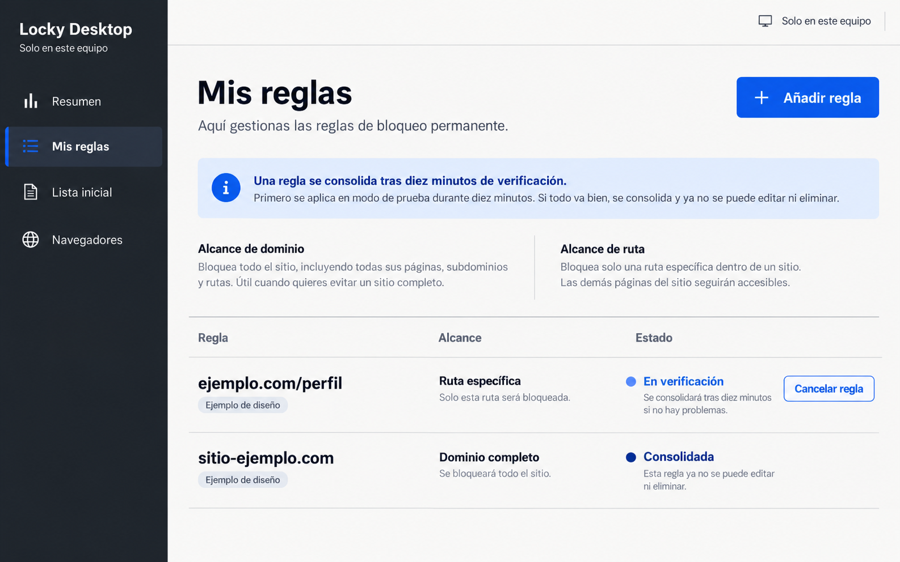

# Dos direcciones para Locky Desktop

Estas imágenes son propuestas visuales generadas con la herramienta integrada de imagegen. No representan funciones ya implementadas. El prototipo actual en `design/` y el `DESIGN.md` vigente no se modificaron.

## A v2 · Energía cotidiana

Revisión de la propuesta A tras el comentario del usuario: sin verde y sin tono formal. Azul eléctrico, naranja, lila y tinta nocturna; titulares grandes y controles claros. La revisión inicial sigue siendo la tarea central. Esta versión reemplaza la dirección de A para cualquier decisión futura; la primera imagen queda abajo como registro de la exploración rechazada.

**Corrección antes de implementar:** la maqueta afirma que la conexión de los navegadores se verificará después de aprobar la lista. Ese orden no está establecido en la especificación y debe eliminarse. El área de “Configuración” y “Ayuda” es exploratoria y no corresponde aún a funciones especificadas.

**Prompt de generación:**

> Use case: ui-mockup. Asset type: revised desktop app design proposal for Locky Desktop, a personal Windows app. Create one high-fidelity 16:10 screenshot-like interface, no device frame. Replace the earlier green, formal first-run design with something bold, fresh, friendly, and energetic while remaining a practical operating interface. Absolutely no green. No botanical, institutional, editorial-serious, bank-like, or corporate look. Spanish first-run overview. The initial adult/gambling domain list has not been supplied and no protection is active. Headline “Primero, revisa la lista.” Status “Configuración pendiente”. Main action “Revisar lista inicial”. Empty-list panel “0 dominios presentados” and “Aún no hay dominios para revisar”. Chrome, Brave, Edge, Firefox, Opera individually “Pendiente de verificación”. Navigation: Resumen, Mis reglas, Lista inicial, Navegadores. Product name “Locky Desktop”. Explain approval of the initial list as a set and the ten-minute cancellation window for new personal rules. Expressive modern desktop utility, electric blue, tangerine, lilac, chalk white, midnight ink. Playful typography, confident asymmetry, crisp vector geometry, readable controls. Bold color fields, no standard white dashboard with colored cards. No gradients, glow, glass, lock-shaped hero art, fake metrics, invented domains, misleading active status, people, photos, or watermark.

## A original · Revisión inicial (rechazada)

Una interfaz serena que hace visible la decisión inicial: qué está pendiente, qué se aprobará y qué navegadores aún no se han verificado. Verde profundo, fondo claro, texto editorial y una acción principal clara. Funciona mejor si la primera experiencia y la confianza en la configuración son la prioridad.

**Corrección antes de implementar:** la maqueta dice que se seleccionan dominios individuales; la especificación exige revisar y aprobar la lista inicial **como conjunto**. Tampoco debe mostrar Chrome, Brave, Edge, Firefox u Opera como protegidos hasta que se verifique cada integración.

**Prompt de generación:**

> Use case: ui-mockup. Asset type: desktop UI concept composition for Locky Desktop, a personal Windows app. Create one high-fidelity 16:10 screenshot-like application interface, no device frame. Design direction A: a calm, precise personal protection control room. Spanish UI. Main screen is the first-run overview: local protection has not been configured; the initial domain list must be reviewed before any domain is blocked. No fake domain entries or protection claims. Slim forest-green left navigation with Locky wordmark and Resumen, Mis reglas, Lista inicial, Navegadores. Warm-white main workspace, headline “Revisa antes de activar”, status “Configuración pendiente”, action “Revisar lista inicial”. Explain Revisar lista, Aprobar conjunto, Protección activa. Show “0 dominios presentados” and “Aún no hay dominios para revisar”. Browser row: Chrome, Brave, Edge, Firefox, Opera, all “Pendiente de verificación”. Restrained editorial software UI, matte surfaces, deep pine green, sage, thin dividers, warm amber for pending. Practical controls. No invented domains, countdown, people, photography, neon, glass, or watermark.

## B · Registro de reglas

Una interfaz más densa y directa para el uso cotidiano. La tabla distingue con fuerza el alcance de cada regla, qué está en verificación y qué ya quedó consolidado. Carbón, blanco tiza y azul cobalto. Funciona mejor si consultar y añadir reglas será la tarea más frecuente.

**Corrección antes de implementar:** la frase “se aplica en modo de prueba” es incorrecta. La página añadida permanece accesible durante los 10 minutos de verificación; solo se bloquea cuando la regla se consolida. Las direcciones visibles son ejemplos ilustrativos.

**Prompt de generación:**

> Use case: ui-mockup. Asset type: desktop UI concept composition for Locky Desktop, a personal Windows app. Create one high-fidelity 16:10 screenshot-like application interface, no device frame. Design direction B: a clear commitment ledger for managing permanent blocking rules. Spanish UI. Show Mis reglas with one illustrative pending route rule and one illustrative consolidated domain rule, both tagged “Ejemplo de diseño”. Pending rule has “En verificación” and “Cancelar regla”; consolidated rule has no edit or removal control. Prominent “Añadir regla”, explanatory domain versus path scope, and ten-minute verification note. Broad dark charcoal navigation rail. Cream-grey main area, firm horizontal rules, large table rows, columns Regla, Alcance, Estado. Cobalt status and primary action. Top bar “Locky Desktop” and “Solo en este equipo”. Contemporary civic record-keeping interface, charcoal, chalk, cobalt, silver, crisp grotesk typography. No real domains: use “ejemplo.com/perfil” and “sitio-ejemplo.com”. No claims of live protection, people, photography, or watermark.

## Decisión pendiente

Estas propuestas exploran direcciones visuales; ninguna ha sido elegida para reemplazar el diseño actual. Al elegir una, conviene adaptar la composición a las demás pantallas y corregir el texto señalado antes de implementarla.
