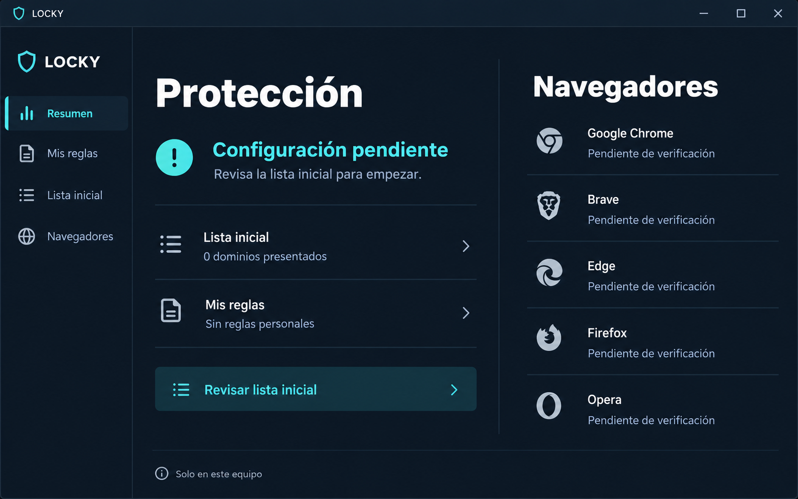

# Locky Desktop · Reference-Based Design

The image attached by the user is a **mobile visual reference**. This deliverable adapts it to a Windows desktop window. It retains the midnight-blue background, large white headings, dividers, simple icons, and turquoise accent. It omits the phone status bar, bottom navigation, and DNS/VPN or Accessibility options because they are outside the Locky Desktop specification.

## Implementation Measurements

| Element | Specification |
| --- | --- |
| Reference window | 1600 × 1000 px; useful minimum 1100 × 700 px |
| Title bar | 52 px high; window controls on the right |
| Sidebar | 264 px wide; 22 px icons; 48 px high items |
| Main area | 44 px padding; two columns: left 58%, right 42%; 56 px gap |
| Main heading | 64 px / 1.08; weight 700 |
| Section headings | 36 px / 1.15; weight 700 |
| Status | 28 px / 1.2; weight 700; supporting line 20 px / 1.4 |
| Rows | Minimum height 96 px, 32 px icon, 1 px divider |
| Primary action | Height 56 px; max width 540 px; radius 10 px; minimum touch/click target 44 px |
| Spacing | 8 px base; groups of 16, 24, 32, and 48 px |

In windows narrower than 1100 px, stack the two columns in the main area; reduce the sidebar to 72 px with accessible names available through tooltips and screen readers. Content can scroll vertically without hiding actions.

## Colors

| Token | Value | Use |
| --- | --- | --- |
| Background | `#14213D` | Window and sidebar |
| Deep background | `#0B1726` | Title bar and contrast areas |
| Primary text | `#F8F5EF` | Headings and values |
| Secondary text | `#B8C5D3` | Descriptions and pending states |
| Action / focus | `#2EC4B6` | Button, selected item, and focus |
| Positive | `#92E6B2` | Verified integration or real protection, only after verification |
| Alert | `#FF6B6B` | Integration failure or action requiring attention |
| Divider | `#304454` | 1 px lines |

The **pending** state must be communicated by text, not a success icon. The mockup uses turquoise to draw attention; in implementation, reserve light green for genuinely verified states and use turquoise for actions and focus.

## States

| Component | Default | Interaction | Pending / error |
| --- | --- | --- | --- |
| Sidebar navigation | Secondary text, light icon | Selected: `#193449` background, 3 px turquoise accent, turquoise text; visible 2 px focus | Remains keyboard accessible |
| “Review initial set” action | `#174150` background, turquoise text; no shadow | Hover: `#1B5060`; pressed: `#123846`; 2 px `#2EC4B6` focus | May open the empty view; **Approve** stays disabled if the real set does not exist |
| Navigation row | Light title, secondary description, chevron | Hover: `#172B3B`; 2 px focus | Text explains the state without relying on color |
| Browser | Name and “Pending verification” state | Row opens details or repair when available | Failure: coral plus “Repair integration”; verified: positive state plus “Protected” |
| Consolidated rule | Explicit “Consolidated” state | Can be viewed | No edit or removal actions |
| Rule under verification | Time and “Cancel rule” action | Can be cancelled for 10 minutes | Added page remains accessible until consolidation |

## Product Fidelity

The mockup shows empty data because the initial domain set and verified integrations are not yet available. “Review initial set” opens the review view but does not authorize approving an empty set. The seven-minute lock screen is a separate surface: it must only say that the lock was activated and offer “Close browsers”, with no domain or countdown.

## Generation

Mode: integrated `imagegen` tool, `ui-mockup`. The user's attached image was used **only as a style reference**. Prompt summary: adapt the midnight-blue mobile interface with white hierarchy, thin dividers, and simple icons into a horizontal Locky Windows window with a sidebar and two columns, truthful pending states, an empty initial set, and browsers awaiting verification; omit the phone bar, bottom navigation, DNS/VPN, and unspecified features.
