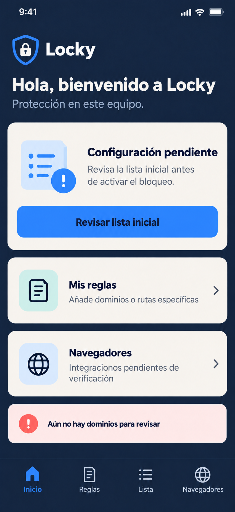

# Locky · High-Fidelity Mobile Concept

This mobile-format mockup was requested to explore the visual style. Locky is a local Windows desktop application built with Electron, not a web app. This mockup does not expand the product scope to include a mobile app.

## Implementation Baseline

- Reference canvas: 390 × 844 dp/pt; content scrolls between the header and bottom navigation.
- Horizontal margins: 16; spacing between blocks: 16–24; card padding: 20–24.
- Four-point grid. Minimum touch target: 44 × 44. Respect top and bottom system safe areas.
- Font: legible sans serif UI font; `Segoe UI` is a natural choice when adapting the design to the Windows app. Weights 400, 600, and 700. Use tabular numerals for displayed times.
- Type sizes: main heading 28/34, card heading 20/26, body 16/24, labels and navigation 13/18; functional text must not be smaller than 13.
- Corner radii: 16 for cards, 12 for buttons and notices, 10 for icons on surfaces.

## Colors

| Token | Value | Use |
| --- | --- | --- |
| `background` | `#14213D` | Background and bottom navigation |
| `surface` | `#F8F5EF` | Cards and primary surfaces |
| `primary` | `#3A86FF` | Primary action and selection |
| `positive` | `#2EC4B6` | Verified or protected state, only when true |
| `alert` | `#FF6B6B` | Alert icon and accent |
| `ink` | `#14213D` | Text on surfaces and blue button |
| `on-dark` | `#F8F5EF` | Text on midnight blue background |

For small text, use `ink` on `primary` (approximately 4.59:1 contrast), `ink` on `positive` (7.37:1), and `ink` on `surface` for alerts. White on `primary` (3.48:1) and coral text on cream (2.55:1) do not meet 4.5:1, so the final mockup uses midnight blue in both cases. Coral communicates alerts through an icon and tinted surface, never as the only indicator.

## Home Screen

| Component | Size / layout | Content and behavior |
| --- | --- | --- |
| Header | 24 top spacing after safe area; flexible height | Locky brand, greeting, and subtitle. Do not claim active protection while setup is pending. |
| Status card | width `100% - 32`, radius 16, padding 24 | “Configuración pendiente” (Setup pending), explanation, and action. Height follows content; do not truncate text. |
| Primary button | Full card width, height 52, radius 12 | “Revisar lista inicial” (Review initial set). Opens the set even when empty; approval stays disabled until actual domains are shown. |
| Shortcut cards | Minimum height 104, radius 16, padding 20, gap 12 | “Mis reglas” (My rules) and “Navegadores” (Browsers); the whole card is actionable. Icon 32, chevron 20. |
| Notice | Minimum height 64, radius 12, padding 16 | “Aún no hay dominios para revisar” (There are no domains to review yet), coral icon, midnight-blue text. |
| Bottom navigation | 72 content height plus safe area, midnight blue background | Inicio (Home), Reglas (Rules), Lista (Set), Navegadores (Browsers). Icons 24, text 12–13. Active indicator uses electric blue plus a label. |

## Component States

| Component | Default | Pressed / focus | Disabled / loading |
| --- | --- | --- | --- |
| Primary button | `primary` background, `ink` 600 text, height 52 | Darken background by 8%; focus uses a 2 px `surface` ring with 2 px offset | 45% opacity if no action is possible; while loading preserve width and show an accessible named indicator |
| Action card | `surface`, `ink` text, no heavy shadow | Darken surface by 4%; 2 px `primary` focus ring | Explain why unavailable; do not rely on opacity alone |
| Bottom tab | Icon and label in `surface` at 75% | Active: `primary`, weight 700, visible indicator; 2 px focus ring | Do not hide essential routes based on state |
| Positive state | `positive` icon or dot plus `ink` text on a surface | Do not rely on color alone | Show only after the integration is actually verified |
| Alert | `alert` icon plus `ink` text on cream or coral-tinted surface | Show a recovery action when one exists | Do not use coral for small text |

## Content and Limits

- The initial set does not yet contain real domains. The screen may open, but approval must remain disabled until the exact set is shown.
- Browser integrations are pending; do not show a positive state before verification.
- A new rule remains accessible during its ten-minute verification period. A consolidated rule has no edit or removal action.
- The future lock screen keeps only the activation message and “Close browsers” action, with no domain or countdown.

## Generation

Mode: integrated `imagegen` tool (`ui-mockup`), with a contrast edit to the first image. Final prompt: Locky mobile screen, background and navigation `#14213D`, surfaces `#F8F5EF`, `#3A86FF` button with `#14213D` text, turquoise `#2EC4B6` for positive states, coral `#FF6B6B` alerts with `#14213D` text; Spanish home screen with setup pending, initial set review, My Rules and Browsers cards, empty-set notice, and bottom navigation. No invented domains or claims of active protection.
